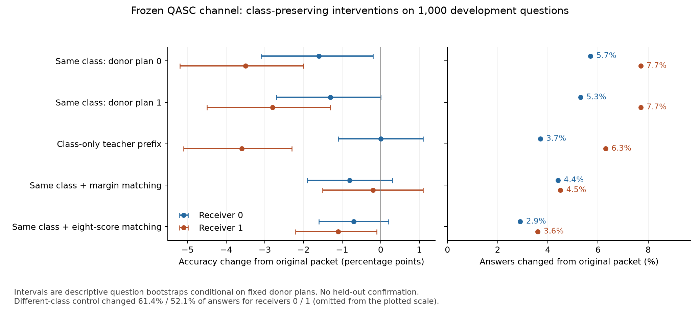

# Reusable communication between frozen language models

Independent, noncommercial student research by Zhenghao Yang, Queen's University.
This public development snapshot contains the current experimental code, checkpoint
revisions, controls, and analysis. It is ongoing research, not a finished paper or
a validated new method. Further evaluation code, methodology, and positive or
negative findings will be released as the pilot progresses, subject to upstream
model, code, and data licences.

## Research allocation, 2026-11-14

The existing QASC results and failed screening criteria remain unchanged. We have
lowered their priority while screening other research directions. The
[cross-field screen](research_direction_screen_20261113.json) records 20 archived
primary sources with explicit reading depth; it does not claim 20 full readings
or an established new contribution. PDF paths refer to the local research library;
paper PDFs and third-party source archives are not included here.

The current candidate asks whether fixed-median latency evaluation misses
input-dependent timing in adaptive visual compression for robot policies.
FastVLA's feature-dependent token budget and LIBERO-Dynamic's frozen-median timing
protocol motivate the question; neither establishes that the effect is material
or that a published result is wrong. The
[bounded first probe](vla_latency_coupling_probe_v1.json) measures timing variability
and resources before closed-loop experiments. No new model experiment has run,
and the QASC held-out cohort remains unopened.

## Scientific status, 2026-11-12

**No validated paper-level contribution or scaling result is claimed.**

The corrected Dream/QASC full run has completed on all 1,000 development questions.
All six same-environment independent author-function prediction checks and all four
applicable message-hash checks pass. The previously fixed contrast and three-peak
shape rule pass, giving a **development-set parity candidate**:

| Exchange round | Cross accuracy | Self accuracy | Cross/self answer agreement |
| ---: | ---: | ---: | ---: |
| 1 | 87.9% | 74.4% | 73.6% |
| 2 | 81.3% | 73.7% | 90.4% |
| 3 | 87.2% | 73.6% | 75.1% |
| 4 | 80.7% | 73.8% | 90.1% |
| 5 | 86.8% | 73.8% | 75.5% |
| 6 | 80.7% | 73.8% | 89.9% |

The primary linear-depth-adjusted parity contrast in answer agreement is
**0.15225**, with question-bootstrap descriptive 95% interval **[0.130875, 0.173417]**.
All 1,000 questions remain in the primary result. These are correlated repeated
measurements from one checkpoint and a development set whose endpoints were
previously inspected; they are not held-out confirmation, a causal mechanism,
or a scaling result. Exact reproduction of the released reference still fails.

In the planned secondary literal-context analysis, the aggregate accuracy advantage between
the two agents alternates across cross-exchange depths on the 701 questions where
the gold option text appears on only one side. The self control does not show
that alternating sign. Literal presence is a proxy, not semantic sufficiency;
no context-swap intervention was performed.

The fixed 192-question numerical sensitivity run has now completed. Disabling
BF16 reduced-precision reduction changed 39 of 4,992 recorded agent/route/depth
predictions, affecting 19 distinct questions, while retaining the three-peak
shape and the primary direction. On this same subset, the primary contrast was
0.201606 before and 0.212674 after the setting change; the paired change was
0.011068, with descriptive 95% interval [-0.007161, 0.032552]. This interval includes
zero; no significant increase is claimed. Predictions and scores are numerically
sensitive, but this particular perturbation does not eliminate the aggregate
candidate pattern. The 192 questions are partly failure-targeted and cannot
establish full-dataset, FP32, or cross-hardware robustness.

This bounded experiment is complete. No further depth search or training has
been launched. A paper-level conclusion still needs independent uninspected
examples, a discriminating mechanism intervention, and a novelty assessment.
See [full-run validation](results/dream_readout_full_v3.summary.json),
[final paired analysis](results/dream_recurrent_v3.final.summary.json), and
[scoped decision](results/dream_recurrent_v3.decision.json).
The earlier [baseline analysis](results/dream_recurrent_v3.baseline.summary.json)
is preserved unchanged.

### Next discriminating experiment: within-class message substitution

A new descriptive analysis of the validated 1,000-question trajectories finds
that first-exchange receiver decisions match the incoming message classifier's
argmax on 911/1,000 and 880/1,000 questions for the two receivers. At depth 6,
re-encoded messages retain the incoming class on 982/1,000 and 985/1,000 questions.
This suggests substantial label relay, but perfect copying is insufficient:
the sender classifier accuracies are 86.2% and 74.9%, while the respective
first-exchange receivers achieve 87.9% and 82.6%. Receiver context or within-class
message information could account for the improvements. These are exploratory
associations from existing results, not new model evaluations.

The [fixed development intervention](remote/dream_label_ablation_protocol_v1.json)
uses all 1,000 questions, both receivers and depth 1. It compares original packets,
two bijective replacements from another question with the **same frozen predicted
class**, a different-class positive control, and a class-only prefix selected from
the original eight-entry training teacher dictionary. No gold answer selects a
replacement. Each projected donor packet is reused bit-for-bit, avoiding a change
in projection numerics caused by reordering its batch. The matched condition must
first reproduce every original receiver label and label logit on all 1,000 questions.

The operational development tolerances are at most two percentage points of
absolute accuracy change and five percent changed predictions, for both receivers
and every class-preserving/class-only arm. Different-class swaps must change at
least twenty percent of predictions in both receivers. Conditional donor-bootstrap
intervals are descriptive, not population equivalence tests. Failure could reflect
confidence or projection geometry rather than rich semantic content. The registered budget was one L4 for at most 20 minutes.
Nine synthetic CPU measurement/plan tests passed before execution. Results are below.

The original [Hidden Messages paper](https://arxiv.org/abs/2610.28905v1) already
discloses task-specific answer-label supervision and answer-oriented prefix targets.
Generic message audits are also prior work
([causal channel audit](https://arxiv.org/abs/2607.26773v1),
[relayed-cache audit](https://arxiv.org/abs/2608.04893v1)). Neither label codes nor
generic swaps are claimed as novel. The empirical question is whether residual
within-class information is necessary for this receiver behavior; a paper would
still require independent confirmation and a contribution beyond this checkpoint.
Official QASC validation's 926 questions remain unopened and unevaluated in this
project. See the [aggregate tracking result](results/dream_label_tracking_v1.json)
and the [original analysis code](analyze_dream_label_tracking_v1.py).

### Class-conditioned intervention result and registered follow-up

The full first-exchange intervention has completed on all 1,000 questions in
11 minutes 22 seconds. Both receiver paths first replayed every baseline label
and every label logit exactly. **The joint class-only sufficiency rule failed.**

| Replacement | Receiver 0 accuracy / changed answers | Receiver 1 accuracy / changed answers |
| --- | ---: | ---: |
| Original packet | 87.9% / 0% | 82.6% / 0% |
| Same predicted class, donor plan 0 | 86.3% / 5.7% | 79.1% / 7.7% |
| Same predicted class, donor plan 1 | 86.6% / 5.3% | 79.8% / 7.7% |
| Different predicted class | 38.7% / 61.4% | 52.6% / 52.1% |
| Fixed class-only teacher prefix | 87.9% / 3.7% | 79.0% / 6.3% |

The different-class positive control is effective. Within-class details affect
behavior, but this does not identify semantic content as the cause. The class-only
prefix retains receiver 0 aggregate accuracy while changing 37 individual answers;
receiver 1 loses 3.6 percentage points. See the [fixed analysis](results/dream_label_ablation_v1.analysis.json)
and [validation/resource summary](results/dream_label_ablation_v1.summary.json).

**Post-result exploratory analysis:** all 37 class-prefix changes for receiver 0
and 59 of 63 for receiver 1 occur in the lowest fifth of original sender top-two
logit margins. These strata were chosen after seeing the intervention results;
they motivate a follow-up, not a confirmatory confidence mechanism claim.
See [uncertainty strata](results/dream_label_uncertainty_v1.json).

The [new fixed follow-up](remote/dream_label_confidence_protocol_v1.json) compares
within-class donors matched either on top-two logit margin or on the eight softmax
scores. All 1,000 questions and both receivers remain; packets are permuted after
projection, with no gold-selected donors, training, or recurrent recomputation.
The matched replay gate remains exact. For an arm to retain a candidate explanation,
both receivers must reduce changed predictions by at least 50% relative to the
prior two random donor plans' mean, while keeping absolute accuracy differences
within two percentage points of matched packets. Matching is approximate, and the
full donor packets remain intact: success would not demonstrate a scalar or
8-score codec. The registered resource cap was one L4 for 15 minutes.
Five new CPU measurement/plan tests passed before execution. The completed result follows.

The first follow-up job stopped before model loading because its plan hash also
included floating diagnostic aggregates. Python 3.14.8 locally and Python 3.11.4
on the cluster produced identical donor indices/classes but diagnostic differences
up to 3.9e-16. The [recorded repair](results/dream_label_confidence_v1.failure.json)
binds every actual assignment exactly and checks floating diagnostics separately
within 1e-12. It changes neither donors nor scientific criteria. The original
failed protocol remains in Git history; the amended protocol is published before
any follow-up model outputs.

The broader ideas are established: [distillation](https://arxiv.org/abs/1503.02531v1)
uses information in soft class targets, [TalkMesh](https://arxiv.org/abs/2609.30578v1)
uses confidence to guide agent communication, and
[MASCAL](https://arxiv.org/abs/2610.39927v1) intervenes on explicit confidence
handoffs. Our potential contribution would need a specific, independently verified
account of this implicit latent channel and its recurrent behavior; generic
uncertainty communication is not new.

### Uncertainty-matched follow-up: completed, fixed joint rule unmet

The repaired job completed in 6 minutes 47 seconds. Actual container donor choices
match the registered assignments exactly, and both 1,000-question matched replays
again reproduce every label and every label logit. No threshold or donor choice
was changed in response to these outcomes.

| Replacement | Receiver 0 accuracy / changed answers | Receiver 1 accuracy / changed answers |
| --- | ---: | ---: |
| Same class + top-two margin matching | 87.1% / 4.4% | 82.4% / 4.5% |
| Same class + eight-score matching | 87.2% / 2.9% | 81.5% / 3.6% |

Relative to the mean of the original two random within-class donor plans (5.5%
and 7.7% changed answers), eight-score matching reduces changes by **47.3% and
53.2%**. It therefore **fails the registered requirement of at least 50% reduction
in both directions**. Receiver 0 has 29 changed answers rather than the required
at most 27.5. We retain this failed screen and the continuous effect sizes; the
cutoff will not be moved. Scalar-margin matching also fails that joint rule.

Both new arms satisfy the earlier looser 2-percentage-point/5%-changed-answer
operational tolerances, but this does not rescue the original class-only hypothesis.
The evidence supports partial preservation of behavior under uncertainty/score
matching on this development set. It does not demonstrate a scalar or eight-score
codec, isolate semantic information, prove calibrated confidence causation, or
establish independent generalization. In particular, the full donor packets
remain present, and rare score patterns are only approximately matched.



See [fixed analysis](results/dream_label_confidence_v1.analysis.json),
[validation summary](results/dream_label_confidence_v1.summary.json),
[scoped decision](results/dream_label_confidence_v1.decision.json), and
[vector figure](results/figures/dream_label_interventions_v1.svg).
The two successful interventions plus the 55-second pre-model failure used
19 minutes 4 seconds of single-L4 allocation. No further donor tuning, training,
or depth expansion is running. The next design priority is independent evaluation
with a development-only donor bank and the still-unopened 926-question split;
that separate protocol and experiment have not yet been executed.

### Earlier stages and preserved failures

The initial C2C experiment asks whether an earlier answer encoding continues to
influence a frozen receiver after its instruction changes. It compares the native
receiver, fusion before the new instruction, and fusion including the new instruction.
The 32-question development run completed on Frontenac. Across 96 correlated
nonidentity answer rotations, native accuracy was 28/96, fusion before the update
31/96, and fusion including the update 30/96. The native competence gate of 60%
failed, so this configuration is not being expanded. A scoring-format issue remains
a possible explanation; the result does not establish an interface-specific failure.
See `results/late_binding_c2c_dev32_v1.decision.json` and the raw predictions.

A separate Dream/QASC branch studies repeated latent-message exchange. The
implementation records cross/self trajectories at depths 0 through 6 and compares
equal incoming messages under different private contexts. The first 16-question
L4 inference check has now completed all four requested conditions:

| Condition | Correct / 16 | Labels equal to the author reference / 16 |
| --- | ---: | ---: |
| One cross exchange (`final_only`) | 15 | 16 |
| Four cross exchanges (`matched`) | 15 | 16 |
| Four self exchanges (`self`) | 15 | 15 |
| No incoming message (`no_message`) | 13 | 15 |

**Exact release validation failed on two labels.** Both self and no-message differ
on one example, in opposite correctness directions. Full-model/decoder parity
was exact in the author's implementation check. The run used PyTorch 2.12.0+cu130
on an L4, took 62.26 seconds including model loading and recording, and peaked at
14.70 GiB of PyTorch-allocated GPU memory (not total device usage). See
`results/dream_validity16_v1.summary.json` for provenance, mismatches and limits.
These selected 16 questions do not provide a scientific accuracy estimate.

A targeted diagnostic has also completed. Repeating the same 16 questions
preserved all self/no-message labels and all four self-message hashes. Restoring
the original complete 64-question blocks around the two discrepancies (128
questions total), including model and channel minibatch composition, preserved
both discrepant predictions. Self labels match 127/128 references and no-message
labels match 126/128. This does not support changed batch membership as the cause
of the original two discrepancies; hardware, numerical and other reference
runtime differences remain unresolved. This post-failure subset is diagnostic,
not an unbiased accuracy estimate. See `results/dream_batch_diagnostic_v1.summary.json`.

The unchanged 0–6-round trace validity stage has now completed on the fixed
16 questions. All six independent author-function prediction checks passed,
as did all four applicable message-hash checks in the same L4 environment.
The trace took 93.56 seconds including setup and those independent calls, with
14.70 GiB peak allocated memory. The same two public-reference discrepancies
remain, so the job correctly exited with a failed release-validation gate.
See `results/dream_trace_validity_v1.summary.json` for checks and provenance.

The L4 self discrepancy is not a final near-tie (B exceeds reference D by
3.890625 logits); the no-message discrepancy is close (H exceeds E by 0.078125).
Neither observation establishes the underlying cause. Further reference-side
runtime/output evidence is needed; unchanged jobs will not be resubmitted.
At that stage, the 1,000-question experiment was unstarted. The original protocol
and primary analysis were fixed before the neural results. The later explicit
amendment and implementation correction are documented below.

This work uses a full L4 on Frontenac;
the 8 GB MyResearchCloud vGPU is intended for bounded small-model profiling and
controls. Successful migration or a Dream-7B fit on 8 GB is not assumed.

## Explicit protocol amendment, 2026-11-10

After the documented small-cohort discrepancies, the researcher authorized a
separate within-environment mechanism experiment. The original v1 files and
failed reference-validation outcomes are preserved. This is an amendment after
observing validation data, recorded before any full1,000-question trajectory.
It does not retroactively make the release reproduction successful.

`remote/dream_trace_amendment_v2.json` specifies the change: exact reference-label
agreement is reported separately, while execution requires matching runtime and
source fingerprints, successful independent author-function comparisons, and
measured memory/time limits. V2 repeats all six implementation comparisons on
the full1,000 questions. The original primary statistic, all depth/shape checks,
common-input controls and inclusion of every question are unchanged.

A fixed192-question numerical probe uses the first64-question block plus the two
previously discrepant blocks, preserving original minibatches. It disables the
BF16 reduced-precision-reduction option described in the
[PyTorch2.12 numerical-accuracy documentation](https://docs.pytorch.org/docs/2.12/notes/numerical_accuracy.html).
This is one setting sensitivity check, not a full-FP32 or cross-hardware test;
identical outputs may mean the selected kernels did not use that option.
All-question analysis remains primary; mismatch-exclusion and worst-case-score
analyses are secondary diagnostics. `analyze_dream_recurrent_v2.py` imports the
unchanged v1 measurements and separately labels the amended interpretation.
The v2 validity job completed successfully: all six prediction checks and four
applicable message-hash checks passed. Its per-question results and token rows
are byte-identical to the earlier v1 trace. The two public-reference discrepancies
remain. The measured projection is 6,061.74 seconds (101.03 minutes, including the
registered margin), with 15.73 GiB peak reserved GPU memory; both resource gates
pass. See `results/dream_trace_validity_v2.summary.json`.

The full 1,000-question run saved every trajectory, then failed its implementation
gate after 67 minutes 51 seconds. All four applicable message-hash comparisons
passed, but five of six independent prediction comparisons failed (only self at
round 4 passed). The dependent numerical probe was cancelled without running.
That failure blocked scientific analysis until the evidenced correction below.
The small validation cohort did not establish full-cohort implementation equivalence. Failure evidence and the
bounded diagnostic plan are in `results/dream_trace_full_v2.failure.json`.

Source inspection identifies a concrete difference to test: the trace takes the
designated agent's answer from a joint two-agent forward, while the author uses a
separate receiver-only terminal forward. Native output also has a full-model
versus decoder path difference; final-only projects receiver messages separately.
The diagnostic completed in 13 minutes 49 seconds. Joint replay exactly repeats
the saved hidden states, labels and logits; receiver-only matched1 readout matches
a fresh author evaluation on all 1,000 questions. Switching from joint to
receiver-only readout changes 2 matched1, 4 matched4, 1 self1, 0 self4, 2 final-only
and 12 native labels. Native receiver-only full-model and decoder logits are
identical, as are the two tested final-only projection paths. This supports a
terminal readout correction; it does not establish the cause of the H100 reference
differences. See `results/dream_readout_diagnostic_v1.summary.json`.

The v3 correction is registered before corrected scientific analysis in
`remote/dream_readout_amendment_v3.json`. It reuses every saved recurrence message,
separately measures both agents at every depth using the author terminal readout,
and repeats the four common-input receiver measurements. The original primary
weights, shape criterion, six depths, all-question inclusion and all six
independent author checks remain fixed. Old failed receipts remain failed.
The corrected full run completed in 67 minutes 35 seconds, within the single-L4
two-hour cap, with 17.64 GiB peak PyTorch-reserved memory. All six independent
prediction checks and all four message-hash checks pass on the full cohort. Input
tokens and question order are unchanged; all cached recurrence messages are reused.

`analyze_dream_recurrent_v3.py` then applied the unchanged primary test, producing
the positive candidate reported above. Public-reference agreement remains
993/1,000 final-only, 989/1,000 matched, 993/1,000 self, and 987/1,000 native.
The mismatch union contains 38 questions. Excluding these in a secondary analysis
retains the three peaks and a contrast of 0.151724. Holding other scores fixed and
allowing these 38 scores to take arbitrary values in [-1,1] yields a mean range
[0.107958, 0.183958] with the original 1,000-question denominator. This is not a
confidence interval or a bound on other numerical errors, nor does exclusion
replace the primary analysis.

The fixed 192-question numerical probe completed in 12 minutes 44 seconds,
within the 20-minute cap. It recomputed recurrence under the changed flag and
used the corrected readouts, with identical selected question IDs and token
rows. Code, model, data, configuration and runtime fingerprints match the
validated baseline; only the planned numerical flag changes. Its validity flag
is intentionally null: this is a setting-sensitivity comparison, not a new
independent-author validity receipt. See
[probe receipt](results/dream_readout_sensitivity_v3.summary.json).

The following changes compare the disabled-flag probe to the corresponding
192 baseline questions. Counts are shown separately for each agent; each maximum
absolute logit difference is over both agents, all 192 questions and answer
classes for that route/depth. These are unnormalized scores, not probabilities.

| Route | Round | Changed labels, agent 0 | Changed labels, agent 1 | Max answer-logit change | Max message-classifier-logit change |
| --- | ---: | ---: | ---: | ---: | ---: |
| native | 0 | 2 | 0 | 0.4531 | 0.5625 |
| cross | 1 | 0 | 4 | 0.9531 | 2.5938 |
| cross | 2 | 2 | 2 | 2.9219 | 10.3618 |
| cross | 3 | 3 | 4 | 4.4844 | 9.6471 |
| cross | 4 | 4 | 3 | 4.1406 | 9.7812 |
| cross | 5 | 3 | 2 | 4.9531 | 9.6279 |
| cross | 6 | 3 | 2 | 4.3594 | 10.0703 |
| self | 1 | 1 | 0 | 0.9219 | 1.1250 |
| self | 2 | 1 | 0 | 0.7500 | 1.6328 |
| self | 3 | 1 | 0 | 0.6250 | 4.3184 |
| self | 4 | 0 | 1 | 1.6250 | 4.5194 |
| self | 5 | 1 | 0 | 2.8672 | 4.5000 |
| self | 6 | 0 | 0 | 1.1875 | 2.6992 |

All observations within one question are correlated; 4,992 is a count of recorded
predictions, not independent trials. Both the subset baseline and perturbation
retain all three required even-round peaks and positive descriptive intervals
for the primary contrast. The complete per-agent score changes, direction checks
and paired estimates are in the final aggregate analysis. This does not resolve
the released-reference discrepancy or prove a causal explanation for the pattern.

Each GPU job uses one L4 and 32 GiB host RAM. Sensitivity jobs are capped at
20 minutes and full experiments at two hours, with empirical resource gates.
Completed old failed runs are not relabelled as successful.

## Contents and provenance

- `remote/`: C2C acquisition/evaluation, pinned model manifests, Dream preparation,
  trace driver, frozen protocol, and Slurm templates.
- `analyze_*.py` and `test_*.py`: standard-library analysis and measurement tests.
- `results/`: observed C2C predictions, resource measurements, analysis, and decision.
- `vendor/c2c_official/PROVENANCE.json`: upstream code URL and exact revision;
  upstream implementation and model weights are not bundled.
- `SNAPSHOT_MANIFEST.json`: local source commit and SHA-256 of source/exported files.
  Cluster home paths in metadata and personal Slurm accounts were generalized;
  experimental Python code and raw predictions are unchanged.

This is a scoped snapshot, not a copy of private conversations, correspondence,
credentials, or the complete historical research archive. Old result file hashes
refer to the original run; the snapshot manifest identifies any metadata edits.

## Recheck existing analysis without a GPU

Run from this repository root with Python 3.11 or later:

```bash
python3 -m unittest test_late_binding_analysis_v1 test_analyze_dream_recurrent_v1 test_dream_trace_v2 test_analyze_dream_recurrent_v2
python3 analyze_late_binding_c2c_v1.py results/late_binding_c2c_dev32_v1.jsonl \
  --metadata results/late_binding_c2c_dev32_v1.json --out /tmp/c2c-reanalysis.json
```

The output path must not already exist. These checks do not load models or constitute
a new neural experiment. The four answer rotations of one question are correlated;
analysis resamples questions, not individual rotations.

## Neural execution and dependencies

Scripts under `remote/` are staged flat into a cluster project work directory with
the root analysis scripts. They retain Slurm/CUDA guards to prevent accidental local
model execution. Set a valid Slurm account and adjust module/wheelhouse settings for
your site; do not run the supplied jobs blindly on a workstation or login node.
The C2C runtime uses a site-specific Transformers 4.52.4 override. Its actual
software versions and measured allocation peak are recorded in the run metadata.
`remote/dream_release_requirements.txt` records the exact Dream package pins.
Use `remote/dream_prepare_container_v1.sbatch` and
`remote/dream_container_python_v1.sh` for the pinned Python 3.11.14 Apptainer
runtime. The module-based `dream_prepare_v1.sbatch` is retained as historical
setup code: its wheel policy failed on this cluster. The container environment
passed CPU imports and ran the 16-question GPU check; the two prediction
mismatches above still block complete release validation. The editable-build
helper `editables==0.5` is installed explicitly because build isolation is disabled.
This is a staged cluster workflow: the pinned upstream checkouts, acquisition
environment and cached model/data must already be present at the paths used by
the preparation script. It is not a self-contained one-command installer.
The optional lexical-context analysis also expects the exact upstream development
data at `external/hidden_messages/data/development.jsonl`; that data is not bundled.

Exact C2C model revisions and file hashes are in
`remote/c2c_acquire_v1_manifest.json`; the upstream code is
https://github.com/thu-nics/C2C at `5eac72b90faf7b3dc2638e874fe7cba1e74c8bcf`.
The Dream implementation targets reproduction of the author release at
https://github.com/alanrbtx/hidden-messages-diffusion-agents/tree/f85b6d8563a2236117407e0df9c6cd60ea406dac.
The upstream repository provides the exact QASC development data and reference
predictions used by the driver; author-reported reproduction is separate from our
independent validation.

## Bounded VLA timing probe (2026-11-14)

The candidate in `vla_latency_coupling_probe_v1.json` now has an executable
preparation and replay path in `remote/vla_*`. No VLA model run or timing result
has been obtained yet. Five small synthetic-data tests validate the analysis
checks; they are not robot experiments.

`remote/vla_latency_protocol_v1.json` fixes the development-only selection rule,
native-output tolerance and conservative continuation criteria before outcomes.
The probe replays at most 72 chronological observations from three public LIBERO
training demonstrations. It compares the independent native OpenVLA-OFT path
against disabled FastVLA, then repeats disabled, fixed-budget and adaptive
compression in balanced orders with episode resets. It measures wall latency,
retained tokens, replay jitter, 20 Hz delivery buckets and actual memory. This
cannot establish closed-loop success or a new scientific contribution.

Preparation is capped at 45 minutes on two CPUs; GPU replay at 30 minutes on one
L4. Dependencies and data are pinned in `remote/vla_latency_assets_v1.json`;
resolved installation reports and freezes must be retained. Copy the `remote/vla_*`
files to the root of the allocated cluster project before running the scripts.
They expect `$HOME/latent_interfaces_v1`, Apptainer and appropriate site-specific
Slurm account/partition settings. Inspect the preparation receipt before supplying
`VLA_PREPARE_RECEIPT` to the GPU script; there is no automatic resubmission.
Model weights, demonstrations, upstream source and private execution records are
not bundled. No model execution is permitted on the local workstation.

## Rights and acknowledgement

Original project code and documentation are available under the [MIT licence](LICENSE).
The ARC-derived development dataset and prediction records containing question text
are provided under **CC BY-SA 4.0**, as specified in their adjacent `.license` files.
See [THIRD_PARTY_NOTICES.md](THIRD_PARTY_NOTICES.md) for attribution, modifications,
source revisions, and the distinction between bundled data and external dependencies.
The project licence does not relicense upstream code, model weights, or benchmark text.

MyResearchCloud / Computing for Humanity approved an allocation on 2026-11-07;
provisioning is pending. No existing experimental result used that allocation.
Future outputs using it will acknowledge MyResearchCloud / Computing for Humanity.
